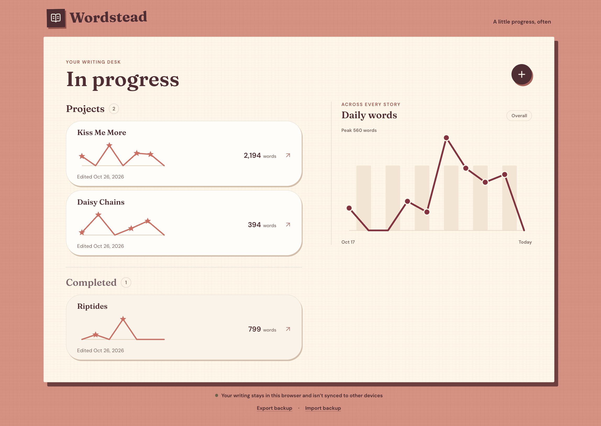
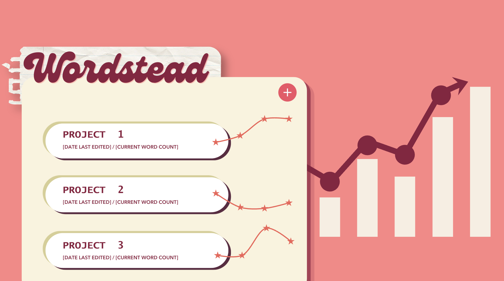

# Wordstead

A writing tracker for people working on several stories at once. Log how many words you write each session, and see your pacing over time as sparklines for each project and for all your writing combined.

**[Try it live](https://madhu-ravuri.github.io/Wordstead-app-v1/)**

## Who it's for

I built Wordstead for myself and my fellow writers in my online writing club. We found each other through sharing our writing on social media and formed our own group together, mostly communicating via Discord or Twitter. We would share ideas, celebrate each other's published pieces, and encourage each other throughout the writing process. On Discord, we would use bots for tracking our writing progress or to oversee writing sprints when we would write together.

Individually, we would track our own progress in various ways as well, mostly using spreadsheets and manually arranging/entering our data in our preferred ways. We enjoy seeing our progress as sparklines as a lot of us are visual, data-driven people. Seeing our writing trends and pacing over time was interesting for us, especially for our unofficial end-of-year reviews.

## Background

Wordstead is a rebuild of a previous version I made for myself earlier this year. This version starts from a full specification and was built in phases, with automated tests and a QA log at every step.

## How to use it

1. Click **+** to create a project. Add a title, and optionally a starting word count, deadline, synopsis, and notes.
2. Log a session by entering how many words you wrote. You can log several sessions a day, or add one for a past day you forgot.
3. Watch your sparklines: each project shows its last 7 days, and the overall chart shows your last 30 days across all projects.
4. Use **Export/Import Backup** to export your data or restore it on another device.

Your data stays in your browser. There are no accounts.

## Key decisions

- **Daily counts, not running totals.** I chose words per day because this is my preferred way of recording progress. I like to see how productive each individual day has been. I enjoy seeing days that I felt more inspired vs days that I may have struggled with my piece. It shows me where I’ve been on a strong streak or started to burn out, and in a future version I want to see this across the entire time it took to finish each piece. Having it recorded by day allows me to compare it with other events on my calendar that could have influenced my writing habits.
- **No accounts.** For v1, I wanted to focus on the functionality of the app itself and make sure I had all the tracking features built first. I don't believe this is an app that requires accounts and prefer local browser storage so users can come into the app, input their counts and update their logs, get a quick view of where they are in their progress, and then get back to writing (or just life in general!). Account management and verification isn't something I plan to include in this app.
- **A postcard-style layout.** I think writing of all kinds and genres is deeply personal and to an extent, vulnerable as well. The original mockup I had designed had a very different layout and format that I liked and fully intended to follow through with. However, the first build ended up with a postcard-like layout and I found that I liked that even more than my original design. A postcard is also a very personal and vulnerable piece of writing, usually handwritten and sent from somewhere special to someone special, and that's how I feel about my writing. The final design of this postcard-style speaks to that.

### Original mockup vs. final design

| Original mockup            | Final design                     |
| -------------------------- | -------------------------------- |
|  |  |

## How it was built

I wrote the product requirements first, then had AI coding agents build it one phase at a time, reviewing and approving each phase before the next.

- [SPEC.md](SPEC.md): the product specification, with testable acceptance criteria for every feature
- [IMP_PLAN.md](IMP_PLAN.md): the phased implementation plan, with verification steps for each phase
- [QA_LOG.md](QA_LOG.md): every error and failed check caught during the build, and how it was fixed

Built with React, TypeScript, and Vite, using GitHub Copilot in agent mode for phase 1 and Claude Code for the rest. Hosted on GitHub Pages.

## What's next

- A toggle on the overall chart to switch between daily word counts and the running total
- Bars behind the overall line showing the running total, paired with the daily counts
- Hover tooltips explaining what changed on each day, such as sessions logged or projects added
- An optional target word count per project, showing the words per day needed to meet a deadline, if users find it useful
- A full-history view for each project, from first session to finish, for end-of-year reviews

Next, my writing group will use v1 and provide feedback on the first build to refine the app and add suggested features that would be valuable to my fellow writers.

## Release notes

### v1.0 (2026-10-26)

- First release
